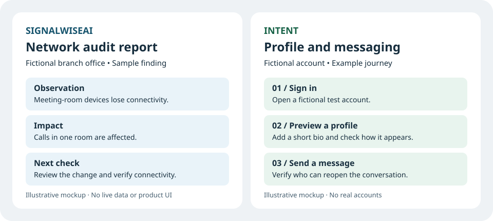

# Peterson Mwai | Project portfolio

Two personal projects that show how I approach technical problems: understand the workflow, make the next action clear, and document what needs to be tested. I'm interested in first- and second-line IT support, with a background in enterprise network troubleshooting.

*These are purpose-built portfolio mockups, not screenshots of either product. All examples are fictional.*

## SignalwiseAI — network audit reporting pilot

I worked on a pilot that turns network-audit observations into structured reports. The goal was to make it easier for a support team to see what was observed, why it matters, and what someone should verify next. The pilot explores AI-assisted report drafting; an engineer still needs to check the evidence before acting.

Demo: review a fictional network finding

**Observation:** At a fictional branch office, meeting-room devices lose connectivity after a scheduled change. Wired desks are unaffected.

**Impact:** The affected room cannot reliably host video calls. The scope does not indicate a site-wide outage.

**Next step:** Compare the before-and-after change records, verify the relevant network segment and connectivity, and record the outcome before closing the issue. The example deliberately leaves the root cause unconfirmed.

## Intent — mobile app prototype

I worked on Intent, a dating-app prototype built with React Native, Expo and TypeScript. The project covers sign-in, profiles and messaging, with setup and testing documented for the private project. This showcases the user journey and how I think about expected behaviour and verification; it is not a public beta or signup page.

Demo: follow a fictional profile and messaging journey

1. **Sign-in:** A fictional test user signs in and reaches their profile.
2. **Profile:** The test user adds a short bio and views the preview.
3. **Messaging:** After a fictional match, the test user sends a sample message.
4. **Checks:** Confirm a signed-out user cannot open the conversation and that the authorised test user can see the saved message after reopening it.

This repository contains portfolio material only. It does not include either project's source code, live services, customer or user data, or credentials.
